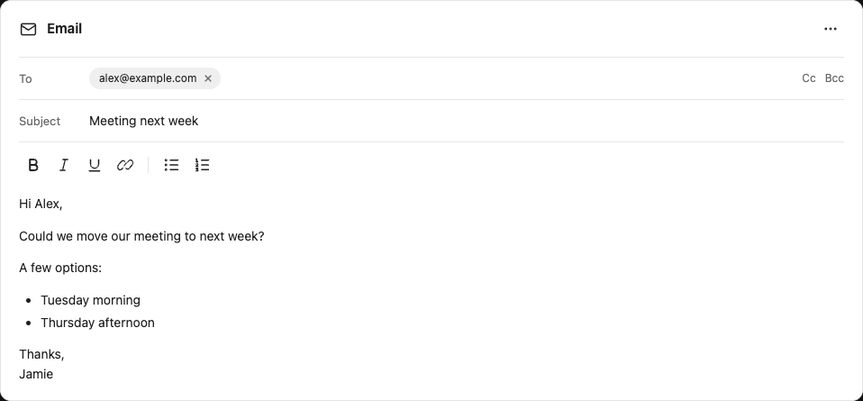
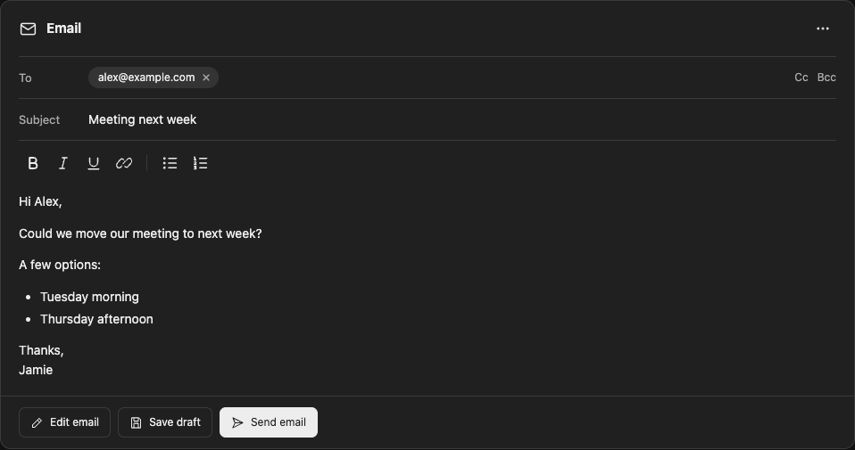

# Open WebUI Plugins

Independent extensions for standard Open WebUI installations. Each plugin has its own folder, installation instructions, examples and version history.

| Plugin | Description | Components | Status |
| --- | --- | --- | --- |
| [Visualizer](native-visualizer/) | Creates charts and diagrams | Skill, system prompt, optional model preset | 0.1.1 preview |
| [Email Composer](email-composer/) | Editable inline email cards and Microsoft 365 draft actions | Action Function, Auto Display Filter, existing MCP connection | 0.2.0 experimental |

Start with the plugin's README. No frontend patches or custom Open WebUI builds are required for Visualizer. Other plugins will document their own requirements.

This project is independent of Open WebUI and Classic298. The collection layout was inspired by [Classic298's plugin collection](https://github.com/Classic298/open-webui-plugins); implementation and instructions here are original.

See [contributing](CONTRIBUTING.md), [security and privacy](SECURITY.md) and the [MIT license](LICENSE).

### Email Composer preview

The Minimal editor appears automatically and supports light and dark themes, with named action buttons inside the card. See the [Email Composer documentation](email-composer/#minimal-editor-light-and-dark) for usage and theme behavior.

