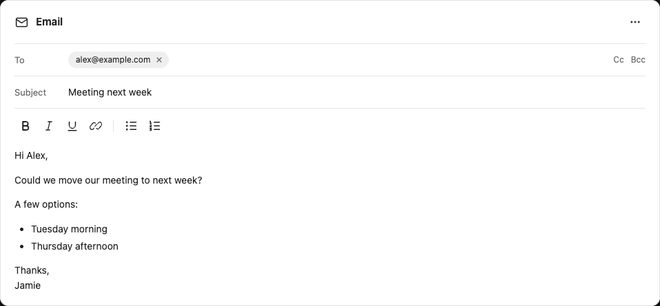
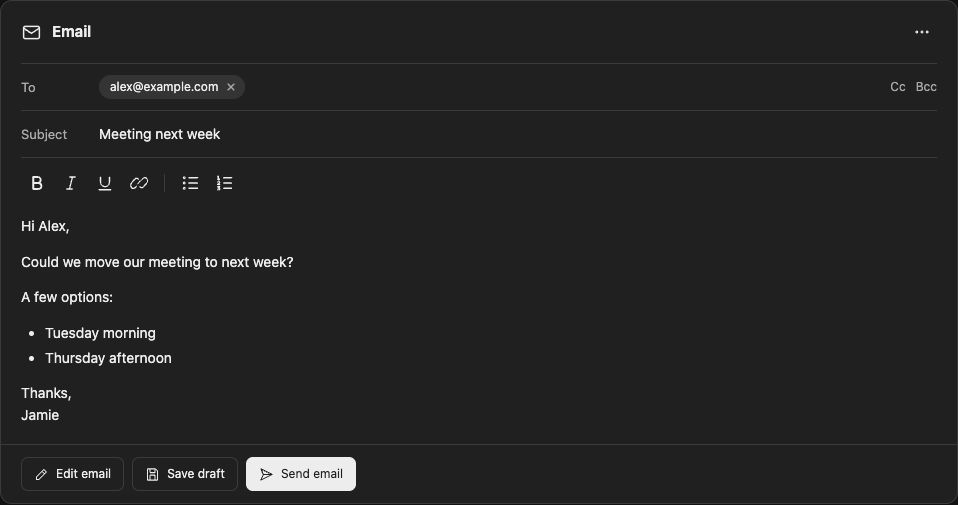

# Email Composer

**0.2.0 experimental preview** — an editable email card inside the existing chat, with native Open WebUI Actions for saving Outlook drafts and submitting them through the [Softeria Microsoft 365 MCP server](https://github.com/softeria/ms-365-mcp-server).

The card has To, CC, BCC, subject, priority, and a rich text editor. The interface and action labels are English. The card now includes named **Edit email**, **Save draft** and **Send email** buttons. A scoped parent bridge delegates saving/sending to the same authenticated native Actions, preserving their frozen-field confirmation and server checks. The message-toolbar fallback uses recognizable pencil, save, send and reload icons. There is no browser extension, frontend fork, model preset, additional service, mailbox token in HTML, or browser-storage credential access.

## Minimal editor: light and dark

The same compact layout works in both themes. These screenshots show the actual sandboxed editor with fictional content, not generated design mockups. The named buttons are inside the card. Screenshots show a fictional configured connection; saving/sending are disabled when the connection or administrator approval is missing.

### Light

### Dark

- Recipient chips with individual removal; CC and BCC are revealed only when needed. Existing CC/BCC recipients are always revealed when a card loads.
- Accessible icon controls for bold, italic, underline, links, bulleted lists and numbered lists.
- Priority is available in the **Email options** menu. Non-normal priority remains visible in the header.
- **Edit email** registers a small native theme bridge for that message. It follows the app's light/dark choice and subsequent changes without losing edits. No credentials or browser storage are read. After a full browser reload, an existing card falls back to the system color scheme until **Edit email** is used again; the sandbox cannot independently read the parent app's theme.

**Not production validated.** Offline tests do not establish working OAuth, Graph delivery, browser CSP compatibility or permissions in your installation. Sending is disabled by default. Do not enable it until the acceptance checklist passes and your administrator approves the plugin.

## Requirements

- Open WebUI v0.13.3 for automatic display through the outlet-filter interface. The fallback Action uses v0.12.5 extension interfaces. Other versions require revalidation.
- Administrator permission to install and execute Python Functions. This is a trusted server plugin and uses the documented `execute` browser event with fixed JavaScript. It runs with parent-page privileges. It does not change sandbox settings or read session storage/cookies. Existing CSP must already allow that native event; do not relax CSP for this package.
- An existing administrator-configured **MCP Streamable HTTP** connection to Softeria, using **per-user OAuth 2.1 or OAuth 2.1 Static**, with stable `WEBUI_SECRET_KEY`. Shared bearer credentials and shared service accounts are outside this package's supported configuration.
- JSON output from Softeria and enabled tools: `get-current-user`, `get-mail-message`, `create-draft-email`, `update-mail-message`. Add `send-draft-message` only for approved sending. Delegated scopes include `User.Read` and `Mail.ReadWrite`; sending also needs `Mail.Send`. Verify actual `tools/list` schemas and `--list-permissions` for your pinned server build. No org-mode requirement is implied solely by having a work mailbox.
- Persistent writable Open WebUI `DATA_DIR`. Store resides at `email-composer/cards.sqlite3`. Multiple workers on one host can use its SQLite transaction lock; multi-node storage/locking is not supported.

No new pip dependencies are declared. Python, FastAPI and Pydantic are already provided by Open WebUI. This does not mean an existing Python/plugin restriction has been resolved.

## Install

1. Review [function.py](function.py), the self-contained generated Function. Do **not** import `action.py`, which is the development template.
2. In **Workspace → Functions**, create an Action Function from `function.py` using ID **`email_composer`**, then activate it. Function IDs accept underscores, not hyphens.
3. In its Valves, set `mcp_server_id` to the existing connection's **internal ID**, not its name or URL. Leave `enable_sending` false.
4. Assign the Action to your existing models. Preserve their system prompts and existing tools/Skills, including Visualizer. No new model is required.
5. Each user must authorize the MCP connection using Open WebUI's normal OAuth flow before using the Actions. This plugin does not implement a login screen or silently borrow another user's authorization.
6. Import [auto-display.py](auto-display.py) as a **Filter Function** with ID **`email_composer_auto`**, activate it and enable **Global**. It only applies its preparation instructions to models already assigned the Email Composer Action; other models are unchanged. It adds instructions after existing system content without replacing it. Replace any older manual-action instructions with [model-instructions.md](model-instructions.md) when maintaining model prompts.
7. Start a new chat and ask for an email. Once the assistant finishes preparing the message, the Filter displays the composer automatically and replaces the structured output with a short ready message. No star-button click is required. Unknown recipients remain editable empty fields; saving still requires a valid To address. The fallback pencil Action can open existing messages manually.

If Functions are blocked, obtain administrator approval; do not bypass the restriction. If the connection requires login, authorize through Open WebUI and retry. A failed call must never be treated as a successful save.

## Use

- **Edit email** focuses the editable message without discarding changes. Edit the card directly. Recipient fields accept plain addresses separated by commas or semicolons. Display names, attachments, images, tables and arbitrary HTML are not supported. Paste is plain text.
- **Save draft** captures the current editor fields and shows a native confirmation containing recipients, subject, priority and the exact HTML body. This preview intentionally exposes HTML source in that confirmation; it is not a polished rich-text confirmation screen.
- The action resolves the current user's existing MCP connection, checks enabled tool names and mailbox identity, then creates or updates the same draft. Removing CC/BCC sends empty arrays to clear them.
- **Send email** requires the current fields to have been saved, administrator enablement, and a separate confirmation. It checks that the draft is still a draft and that its `changeKey` matches the last saved version.
- **Load saved card** restores the server's saved fields after confirmation, discarding local edits. It also refreshes the revision after reopening an older chat. Opening the composer again on the same message reuses its server record.
- A successful send means the MCP/Graph submission was accepted, **not that delivery was confirmed**. Status in the card is authoritative; the model does not reconstruct or execute the editor action.

Saving and sending both require a live connected browser and a configured Microsoft 365 connection. The Filter automatically opens new email responses; it does not save drafts or submit mail. Card buttons invoke only the fixed save/send Actions on the same message and accept replies only from their parent. After a full browser reload, use the fallback pencil **Edit email** Action to re-register the native bridge for an existing card; this is required before in-card save/send and explicit app-theme synchronization. No sandbox or CSP permissions are changed. No automatic background autosave is performed. Changes made while a save is in progress remain in the editor and are labelled unsaved after acknowledgement. Do not navigate away with unsaved changes: local edits are not persisted until an action succeeds.

## Safety and operational limits

The native Action endpoint authenticates the caller and checks chat ownership. The plugin binds records to user, chat, and message; resolves OAuth on the server; and uses a fresh nonce and exact iframe window check for state transfer. No bearer credentials are embedded in the card. The DOM selector for the message iframe is version-sensitive and needs browser acceptance testing. Messages containing multiple top-level embeds fail closed.

SQLite transaction claims prevent concurrent duplicate operations on a card. After a mutation timeout, malformed mutation response, or interrupted process, the card is `unknown` or `busy` and cannot be retried automatically. An administrator must reconcile the pending operation against Outlook before repairing state. There is intentionally no reset/retry button that could create duplicate drafts or submissions. Do not create another card/chat to retry an uncertain send.

External Outlook edits are checked before updating/sending. **A simultaneous external edit between the check and the mutation remains a race:** this preview does not implement Graph conditional updates/sends and cannot promise exact-once delivery or atomic content confirmation against external writers. Keep the draft closed in Outlook during acceptance; do not deploy where stronger concurrency guarantees are required.

The Graph service may normalize HTML and recipients. This version checks returned draft metadata, but does not perform a full semantic read-back comparison. Optional Softeria signoff settings or downstream mail rules can also alter content; test and include any required signoff visibly before approval. Do not enable sending if content transformations have not been assessed.

The plugin bypasses a *model's* decision to call a tool by executing an authorized native Action; it does not replace your administrator's policy approval. Enforce connection access and tool allowlists on the server. Avoid additionally exposing raw send tools to models if all sends must pass this plugin's confirmation.

## Privacy, retention, removal

The plugin stores email fields, mailbox ID, draft ID, revision, timestamps and pending-operation data in the persistent SQLite database. Treat it and its backups as mailbox data. The file is created with owner-only permissions; underlying disk/backups must follow your deployment's encryption/access/retention policy. It stores no OAuth tokens. Chat history stores the initial card content too; sharing/exporting a chat can disclose that text, but does not grant access to its server record or mailbox. Unsaved local changes are not included in the original chat export.

There is no automated retention/cleanup in this preview. To remove, detach and delete the Function. Coordinate removal of `DATA_DIR/email-composer/` and relevant chat/backups according to retention policy. Removing local data does **not** delete Outlook drafts or revoke OAuth grants.

## Validation and acceptance

For the isolated sandbox browser check (including app light/dark switching, recipient chips, CC/BCC, list and link editing, and 320/360px layouts), install Playwright in your development environment and run `node tests/email-composer-browser.cjs` from the repository root. Set `CHROME_PATH` to an existing Chromium executable if needed; `SCREENSHOT_DIR` optionally saves both theme screenshots. This check does not run inside Open WebUI.

Offline: run `python3 scripts/build-email-composer.py`, `python3 -m unittest discover -s tests -p '*_test.py'`, and the repository's `npm test`. Tests mock Open WebUI and MCP and never connect to a real mailbox.

Before deployment, verify with fictional messages and authorized test mailboxes:

- Card appears automatically after a new email response in v0.13.3 with unchanged sandbox/CSP; named in-card buttons and fallback toolbar Actions target the intended card.
- Hand-edited recipients, cleared CC/BCC, subject, quotes, non-ASCII text, links and supported formatting arrive correctly in Outlook. Inspect the confirmation and actual mailbox content.
- Saving twice updates the same draft. Two rapid clicks produce one mutation. Edits during saving remain visibly unsaved.
- Two users cannot load/modify each other's records; reconnecting to another mailbox stops the action.
- Cancel, socket loss, expired/revoked login, MCP errors and timeouts never show false success. Unknown outcomes prevent another mutation.
- External changes stop the next action. Assess the documented concurrency race before enabling sending.
- With sending approved, use a controlled recipient, verify the exact message and Sent Items, and verify that repeated clicks do not resubmit.
- Reopen a chat, reload saved state, restart a worker, and check recovery behaviour and persistent storage.

| Evidence | Status |
| --- | --- |
| Offline state, payload, isolation and mocked MCP workflow tests | Passed locally |
| v0.12.5 Action, embed, socket callback and MCP OAuth interfaces | Source inspected |
| Isolated Chromium sandbox: light/dark switching, exact edited fields, recipient chips, lists/links, desktop/320/360px layouts, runtime errors | Passed locally |
| Open WebUI v0.13.3 editor rendering and native confirmation | Validated with fictional content; no mailbox operation |
| OAuth and Microsoft 365 operation | **Not tested** |
| Production readiness | **Experimental** |

Sources: [v0.12.5 Actions](https://github.com/open-webui/open-webui/blob/v0.12.5/backend/open_webui/utils/actions.py), [native browser events](https://docs.openwebui.com/features/extensibility/plugin/development/events/), [MCP resolution](https://github.com/open-webui/open-webui/blob/v0.12.5/backend/open_webui/utils/tools.py), [Softeria endpoints](https://github.com/softeria/ms-365-mcp-server/blob/6f862af02568974b82867a366629b3f09b12d434/src/endpoints.json).

Original implementation under the collection's MIT license. The visual pattern was inspired by [Classic298's composer](https://github.com/Classic298/open-webui-plugins/tree/main/email-composer); no source was copied.
